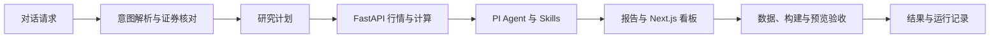

# SignalForge

**智能量化投研与策略分析工作台**

面向股票、指数与 ETF 的量化研究工作台，支持通过对话查询行情、回测均线策略，并生成报告与交互看板。每次研究保留数据来源、计算参数和运行记录。

 

[项目案例](docs/project-case.md) · [架构设计](docs/architecture.md) · [本地运行](docs/quick-start.md) · [验证记录](docs/validation-status.md)

沪深 300 趋势研究看板：K 线、均线、成交量与风险摘要（页面节选）。

## 研究场景

| 输入 | 结果 |
| --- | --- |
| 分析沪深 300 近期趋势 | K 线、均线、量价结构与风险摘要 |
| 用 20/60 日均线回测 510300 | 净值、回撤、交易明细与实验快照 |
| 查看贵州茅台的基本面 | 行情、财务、公告与数据质量信息 |

## 核心实现

- **Agent 与 Skills 编排。** PI Agent 按阶段加载行情、回测和看板生成 Skills，结合证券核对、上下文预算、有限重试与定向修复执行任务。
- **行情存储与缓存。** FastAPI 接入东方财富、Baostock 等来源，TimescaleDB 保存历史行情，Redis 缓存分时查询；优先读取本地数据，补齐缺失区间。
- **回测与结果复算。** 按下一根开盘模拟成交，计入费用与固定滑点；保存行情快照和策略参数，支持独立账本核对与离线复算。
- **任务恢复与产物验证。** PostgreSQL 保存任务状态，结合事务 Outbox、租约与心跳支持故障接管；生成看板通过数据、构建及预览检查后交付。

## 技术与运行

Python / FastAPI · TypeScript / Next.js / React · PI Agent · PostgreSQL / TimescaleDB · Redis

运行环境为 Node.js ≥ 22.19、Python ≥ 3.14、uv 和 Docker；完整生成与预览使用 Linux/WSL2。安装、模型配置和启动步骤见[本地运行](docs/quick-start.md)。

## 验证与范围

已完成前后端回归、真实行情与存储集成、浏览器检查及一个真实模型看板样本验收。测试范围与运行记录见[验证记录](docs/validation-status.md)，持续集成状态见页首 Quality。

对话回测目前支持单标的均线交叉、做多或空仓，未接入实盘交易。成交模拟与数据口径见[研究正确性](docs/research-correctness.md)。

## 代码入口

| 模块 | 入口 |
| --- | --- |
| 请求、证券与研究计划 | [Finance Domain](src/lib/domains/finance/) |
| Agent 与执行约束 | [PI Runtime](src/lib/agent/pi/)、[上下文管理](src/lib/agent/context/) |
| 行情、指标与回测 | [Python market-data](services/market-data/) |
| 持久任务与交付判定 | [任务队列](src/lib/quant/generation-queue.ts)、[Mission store](src/lib/services/pi-agent-mission-store.ts) |

专题、接口和开发资料见[文档索引](docs/README.md)。
