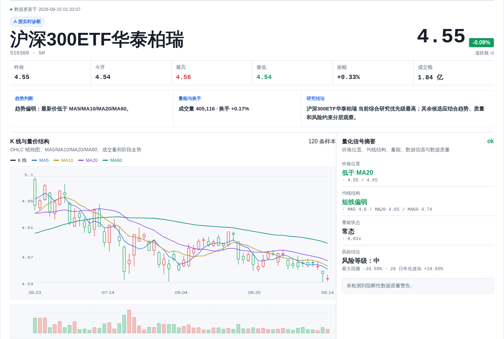
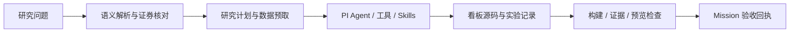

# SignalForge

**把自然语言研究问题，变成带数据来源、实验记录和验收结果的研究看板。**

[](https://github.com/xbzz1018/SignalForge/stargazers) [](https://github.com/xbzz1018/SignalForge/actions/workflows/quality.yml) [](LICENSE)

[项目案例](docs/project-case.md) · [本地运行](docs/quick-start.md) · [验证记录](docs/validation-status.md) · [技术文档](docs/README.md)

面向 A 股、指数与 ETF 的个人 Data Agent 项目。用户提出研究目标，系统解析标的、获取行情、调用分析与回测工具，再生成可预览的 Next.js 看板。每次研究保留数据和执行证据，便于检查与复盘。项目用于研究，不执行自动交易。



<sub>2026-09-15 本地 ETF 技术分析任务的真实生成页面节选。[截图来源与验证记录](docs/validation-status.md)</sub>

## 用它做什么

| 研究问题 | 交付内容 |
| --- | --- |
| “分析沪深 300 近期趋势与回撤” | K 线、均线、量价及风险摘要 |
| “用 20/60 日均线回测 510300” | 净值、回撤、交易明细与可离线复跑的实验记录 |
| “查看贵州茅台的盈利质量” | 行情、财务、公告与数据质量看板 |
| 比较标的、检查持仓风险 | 横向比较、风险暴露与来源记录 |

行业/板块分析和开放式策略研究仍在规划中。真实任务能否完成，取决于数据覆盖、模型响应和交付检查；[当前限制](docs/validation-status.md#待完善项)单独记录。

## 工程实现

**把语义解析与数据核对分开。** Query Rewrite 提取研究意图，证券 Resolver 确认代码与资产类型。初始计划在 PI Agent 执行前形成；Agent 在受控工具、Skills 和预算内完成分析与页面生成。

**把实验留下来。** FastAPI 服务提供行情、指标和回测；实验保存实际输入 K 线、周期、复权、参数、费用、引擎身份与哈希。离线 replay 用于检查记录和复算结果是否一致。

**以验收回执结束任务。** Agent 提交候选产物后，平台继续检查构建、数据与产物契约、预览状态。Mission 关联 accepted receipt 后才标记交付完成。PostgreSQL Job/outbox、Worker lease 与 fencing 管理长任务和写入边界。



[看完整案例与设计取舍 →](docs/project-case.md)

## 运行与验证

开发环境：Ubuntu 22.04 / WSL2、Node.js 24、Python 3.14、uv 和 Docker。Web 使用 Next.js/React/TypeScript；Python/FastAPI 提供数据与计算，PostgreSQL/TimescaleDB 保存状态和行情，Redis 缓存部分热点读取。

```bash
git clone https://github.com/xbzz1018/SignalForge.git
cd SignalForge
npm ci
uv sync --project services/market-data --extra baostock --extra akshare --locked
```

接着按[本地运行指南](docs/quick-start.md)配置服务端模型凭据、启动数据库和应用。Memory、知识服务与集中日志为可选组件。

拉取依赖更新后重新执行 `npm ci` 和带 `--locked` 的 `uv sync`；审计范围见[依赖维护记录](docs/validation-status.md#依赖维护记录)。

| 要检查什么 | 入口 |
| --- | --- |
| 静态检查、测试、构建与确定性合同 | [Quality CI](https://github.com/xbzz1018/SignalForge/actions/workflows/quality.yml) |
| 本机环境与实际所选模型 | `npm run doctor:full -- --model=deepseek-v4-flash` |
| 行情是否跟上交易日 | `npm run check:market-freshness` |
| 真实模型任务与已知失败 | [验证记录与边界](docs/validation-status.md) |

## 从哪里读代码

| 关注点 | 代码 / 文档 |
| --- | --- |
| 研究意图与金融计划 | [Finance Domain](src/lib/domains/finance/) |
| Agent 工具循环与执行约束 | [PI Runtime](src/lib/agent/pi/)、[上下文管理](src/lib/agent/context/) |
| 行情、指标与回测 | [Python market-data](services/market-data/)、[策略与回测指南](docs/strategy-platform-guide.md) |
| 持久任务与完成判定 | [队列](src/lib/quant/generation-queue.ts)、[Mission store](src/lib/services/pi-agent-mission-store.ts)、[证据核验](src/lib/agent/mission/evidence-verifier.ts) |

更多页面入口、部署、评测与排障见[技术文档总览](docs/README.md)。源码中的 `QuantPilot`、数据库标识和环境变量沿用内部名称。
