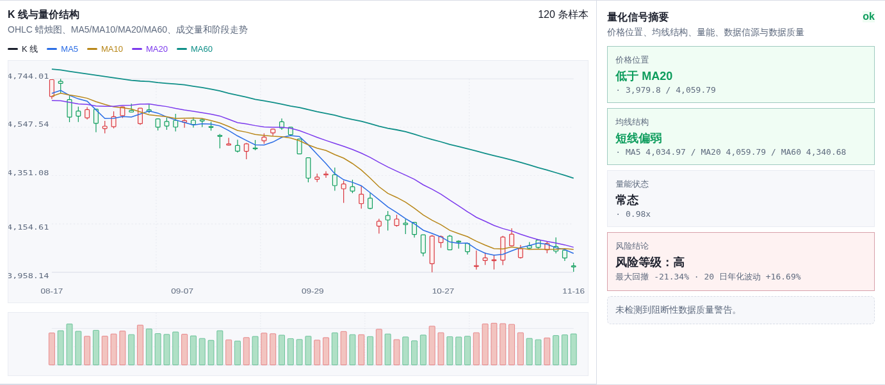
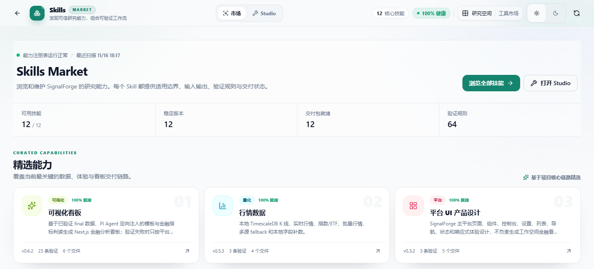
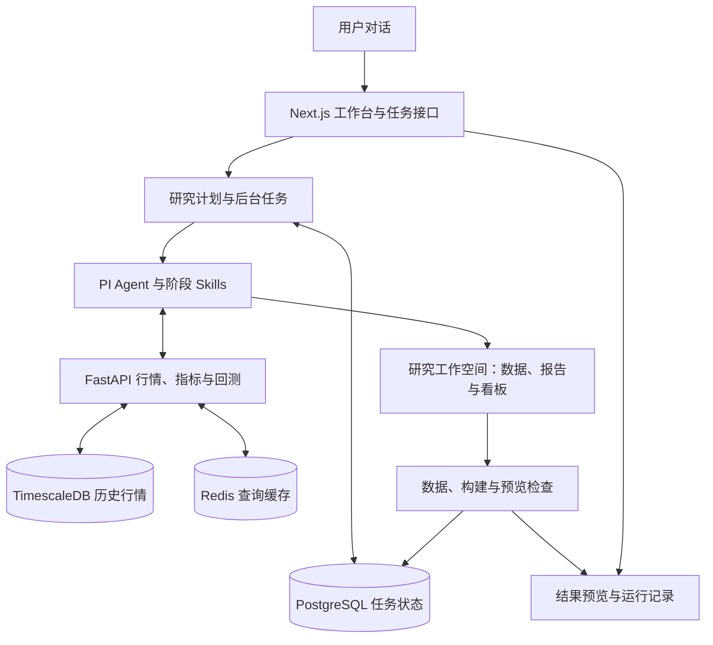

# SignalForge

**智能量化投研与策略分析工作台**

面向股票、指数与 ETF 的量化研究工作台，支持通过对话查询行情、回测均线策略，并生成报告与交互看板。每次研究保留数据来源、计算参数和运行记录。

 

[项目案例](docs/project-case.md) · [架构设计](docs/architecture.md) · [本地运行](docs/quick-start.md) · [验证记录](docs/validation-status.md)

沪深 300 趋势研究看板：K 线、均线、成交量与风险摘要（页面节选）。

## 研究场景

| 场景 | 可以提出的问题 | 研究结果 |
| --- | --- | --- |
| 趋势分析 | 分析沪深 300 近期趋势 | K 线、均线、量价结构与风险摘要 |
| 策略回测 | 用 20/60 日均线回测 510300 | 净值、回撤、交易明细与实验快照 |
| 基本面研究 | 查看贵州茅台的基本面 | 行情、财务、公告与数据质量信息 |
| 持续研究 | 在已有项目中调整参数、继续追问 | 关联历史对话、数据文件和结果预览 |

研究之外，工作台还提供股票与 ETF/指数池、数据覆盖与补数、Skills 管理、报告档案、评测和运行诊断入口。各页面的职责见[使用指南](docs/quick-start.md#第一次研究)。

## 一次研究如何完成

以“用 20/60 日均线回测 510300”为例，任务会形成一个保存对话、数据、源码和预览的研究工作空间：

1. **确认研究范围。** 解析证券、日期和策略参数，独立核对证券身份；信息不足时先澄清，确定后保存研究计划。
2. **准备数据与计算。** 查询本地行情覆盖，按需补数，由后端计算指标和回测结果，记录数据来源与实际参数。
3. **生成报告与看板。** PI Agent 结合阶段 Skills 和已保存的数据生成 Next.js 页面，展示图表、指标和研究说明。
4. **检查并交付。** 核对数据与请求是否一致，执行构建和预览检查；验证失败时修复明确失败项，通过后关联结果与运行记录。

页面、数据和任务记录保存在同一个项目中，后续可以继续追问、调整参数并检查各次运行。实际样本和实现取舍见[项目案例](docs/project-case.md)。

## 核心设计

### Agent 与 Skills 编排

PI Agent 负责多轮工具执行，平台负责研究计划、工具权限、上下文预算和任务状态。历史筛选与摘要控制模型输入规模，有限重试、重复调用检测和终止条件约束异常循环。

行情获取、标的解析、指标计算、策略回测、数据质量及看板生成分别由 Skills 定义输入输出、参考资料与完成条件。运行时按阶段加载所需规则；技能源码、版本和发布包统一维护，避免把所有说明一次性塞进上下文。

Skills 能力总览：查看技能版本、输入输出约束及验证规则（页面节选）。

Skills 的组织、打包与版本管理见[Skills 治理](docs/skills-governance.md)。

### 行情存储与计算服务

Python/FastAPI 接入东方财富、Baostock 等数据来源，为股票、指数和 ETF 提供行情、指标与回测接口。历史行情保存在 TimescaleDB，分时查询使用 Redis 短期缓存；研究优先读取本地覆盖，缺失区间补齐后复用。

数据响应保留来源、观测时间和质量信息。金融指标与资金账本由后端计算，看板读取已保存的结果；缺失字段和过期数据通过质量信息传递给研究任务。数据口径见[行情数据源](docs/market-data-source-knowledge.md)。

### 策略回测与结果复算

对话入口支持单标的均线交叉回测，将日期、窗口、初始资金、费用和滑点固定为本次计算参数。回测按收盘信号、下一根开盘成交的顺序处理，输出净值曲线、回撤与交易明细。

每次实验保存实际行情快照、参数、引擎身份及结果校验值。独立账本核对现金、持仓、费用和收益；保存的响应可在匹配的本地环境离线复算，无需重新取数或调用模型。计算口径见[研究正确性](docs/research-correctness.md)，复跑方法见[策略平台](docs/strategy-platform-guide.md#保存回测并离线复跑)。

### 后台任务与交付验证

PostgreSQL 持久化任务状态，任务与 Outbox 在同一事务写入；重复请求通过幂等校验处理。Worker 使用租约与心跳领取任务，失联后允许重新接管，拒绝旧执行者的迟到结果，并限制同一项目并发写入。

Agent 提交候选产物后，平台继续检查数据证据、产物契约、构建与预览；验收记录必须匹配当前产物版本，通过后才将任务标为完成。任务恢复需要重新规划，具体机制见[后端可靠性](docs/backend-reliability.md)。

## 系统结构

Next.js 承接用户交互与任务接口，PI Agent 执行研究和生成，FastAPI 提供行情与计算。数据库保存任务与行情，工作空间保存数据原件、页面源码和验证产物。

服务分层、并发控制与工作空间生命周期见[架构设计](docs/architecture.md)。

## 技术与代码入口

| 层次 | 技术与职责 | 代码入口 |
| --- | --- | --- |
| 工作台 | TypeScript、Next.js、React；对话、项目与预览 | [应用页面](src/app/) |
| 研究执行 | PI Agent、Skills；工具循环与上下文控制 | [PI Runtime](src/lib/agent/pi/)、[Skills](.pi/skills.registry.json) |
| 领域计划 | 证券核对、请求解析与研究计划 | [Finance Domain](src/lib/domains/finance/) |
| 数据与计算 | Python、FastAPI；行情、指标与回测 | [market-data](services/market-data/) |
| 持久化 | PostgreSQL、TimescaleDB、Redis；任务、行情与缓存 | [任务队列](src/lib/quant/generation-queue.ts)、[数据仓储](services/market-data/src/quantpilot_market_data/repositories/) |
| 质量检查 | pytest、Playwright；后端计算与页面核心流程 | [后端测试](services/market-data/tests/)、[页面测试](tests/e2e/) |

## 本地运行

运行环境为 Node.js ≥ 22.19、Python ≥ 3.14、uv 和 Docker；完整生成与预览使用 Linux/WSL2。Web、行情服务和 Worker 运行在应用环境中，Docker 提供数据库与缓存。

安装、模型配置与首次研究见[本地运行指南](docs/quick-start.md)；可选服务与配置项见[配置指南](docs/configuration.md)。

## 验证与支持范围

已完成前后端回归、真实行情与存储集成、浏览器检查及一个真实模型看板样本验收。测试范围、截图来源与运行记录见[验证记录](docs/validation-status.md)，持续集成状态见页首 Quality。

当前对话回测采用单标的、做多或空仓模型，未模拟完整交易约束，也未接入实盘交易。后端其他预置策略与对话回测的支持范围分别记录在[研究正确性](docs/research-correctness.md)中。

专题、接口和开发资料见[文档索引](docs/README.md)。
