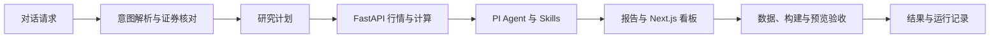

# SignalForge

**智能量化投研与策略分析工作台**

面向股票、指数与 ETF 的个人项目，支持通过对话查询行情、回测均线策略，并生成图表和研究报告。研究任务关联数据来源、计算参数、运行记录与独立工作空间，便于核查结果。

 

[项目案例](docs/project-case.md) · [架构设计](docs/architecture.md) · [本地运行](docs/quick-start.md) · [验证记录](docs/validation-status.md)

2026-11-16 真实模型任务的图表区域节选，使用 120 根日线。该任务通过构建、数据契约、桌面及移动预览检查；截图仅展示界面。[来源与裁切记录](docs/evidence/20261116-showcase.json)

## 研究场景

| 输入 | 结果 |
| --- | --- |
| 分析沪深 300 近期趋势 | K 线、均线、量价结构与风险摘要 |
| 用 20/60 日均线回测 510300 | 净值、回撤、交易明细与实验快照 |
| 查看贵州茅台的基本面 | 行情、财务、公告与数据质量信息 |

## 核心实现

- **有边界的 Agent 执行。** 先解析请求并独立核验证券，再由 PI Agent 按阶段加载 Skills；结合上下文预算、有限重试和定向修复控制执行过程。
- **本地行情优先。** FastAPI 接入东方财富、Baostock 等来源，TimescaleDB 保存历史行情，Redis 缓存分时查询；缺失区间补数后复用本地数据。
- **回测带着输入保存。** 按下一根开盘模拟成交，计入费用与固定滑点；保存行情、参数和费用配置，使用独立账本核对与离线复算检查结果。
- **完成以验收为准。** PostgreSQL 事务、Outbox 和租约管理任务；生成页面经过数据证据、产物契约、构建和预览检查，通过后才记录交付完成。

标准任务可复用受控模板；需要模型生成时进入 PI Agent 工具循环。金融指标和回测由后端计算，页面引用已保存的数据。[案例与设计取舍 →](docs/project-case.md)

## 技术与运行

Python / FastAPI · TypeScript / Next.js / React · PI Agent · PostgreSQL / TimescaleDB · Redis

开发环境要求 Node.js ≥ 22.19、Python ≥ 3.14、uv 和 Docker。生成代码的隔离构建、预览在 Linux/WSL2 中运行。安装、模型配置及启动步骤见[本地运行](docs/quick-start.md)；Memory、知识服务与集中日志为可选接入。

## 验证与范围

2026-11-16 本地验收：TypeScript 单元测试 1489 项、Python 测试 269 项通过；生产构建、57 项浏览器检查和一个真实模型看板样本通过。测试环境、跳过项与失败历史见[验证记录](docs/validation-status.md)，远端检查以当前提交的 Quality CI 为准。

对话回测目前支持单标的均线交叉、做多或空仓；尚无自动实盘交易，也未模拟完整交易约束。一个模型样本不代表长期成功率。

## 代码入口

| 模块 | 入口 |
| --- | --- |
| 请求、证券与研究计划 | [Finance Domain](src/lib/domains/finance/) |
| Agent 与执行约束 | [PI Runtime](src/lib/agent/pi/)、[上下文管理](src/lib/agent/context/) |
| 行情、指标与回测 | [Python market-data](services/market-data/) |
| 持久任务与交付判定 | [任务队列](src/lib/quant/generation-queue.ts)、[Mission store](src/lib/services/pi-agent-mission-store.ts) |

专题、接口和开发资料见[文档索引](docs/README.md)。
