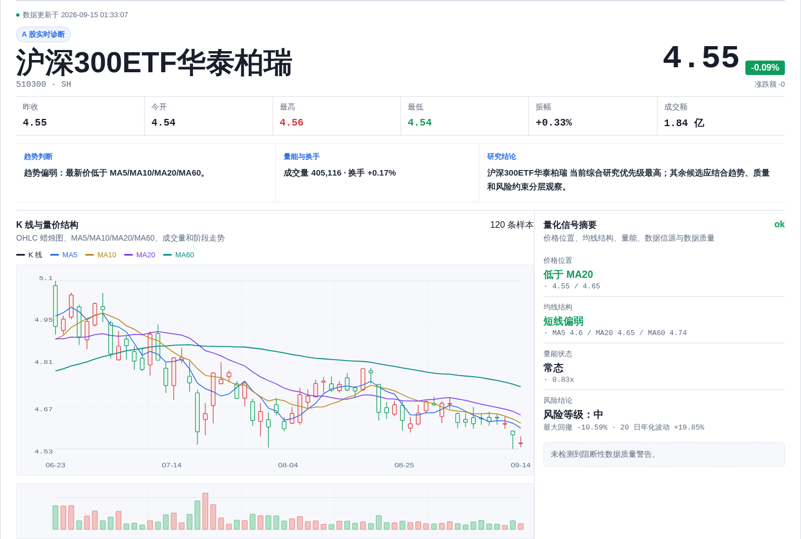
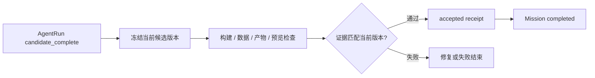

# 项目案例：从研究问题到可检查的看板

[仓库首页](../README.md) · [本地运行](quick-start.md) · [验证记录](validation-status.md)

## 研究过程为什么需要留下证据

用户问“沪深 300 近期趋势如何”时，单条文字回答很难让人确认取了哪段行情、指标怎样计算、图表是否引用同一份数据。SignalForge 把研究请求、数据获取、计算和看板生成放进一个工作空间，让读者能够沿结果回到数据与执行记录。

项目实现覆盖 Web/API、Finance Domain、PI Agent 工具适配、Python 行情与回测服务，以及任务持久化和交付检查。技术难点是让这些步骤共享可追踪的身份与状态，并明确一次执行结束和一次研究交付完成之间的差别。

## 一次任务怎样走完

以“用 20/60 日均线回测 510300”为例：

| 阶段 | 系统工作 | 留下的内容 |
| --- | --- | --- |
| 解析 | Query Rewrite 提取研究意图；Resolver 独立确认证券 | task、query rewrite、finance run plan |
| 取数 | 按计划请求 FastAPI 行情/回测服务 | 原始响应、来源、质量说明与实验快照 |
| 生成 | PI Agent 使用工具和 Skills 写入 Next.js 工作空间 | 页面源码、最终数据、工具事件 |
| 提交 | `submit_result` 提交候选版本 | candidate receipt 与当前版本身份 |
| 验收 | 核对构建、产物/数据契约和预览就绪证据 | 验证报告、accepted evidence receipt、Mission 终态 |

图为 2026-09-15 本地 ETF 技术分析任务的生成页面节选。该截图展示看板形态；回测任务另有[历史运行结果与数值边界](validation-status.md)。

## 取舍一：先固定研究边界，再让 Agent 执行

初始语义解析、证券核对和计划生成在 PI Agent loop 之前完成。模型负责提取意图，证券身份交给 Resolver 核实；模型不可用、关键信息不足或缺少原文证据时，走澄清或失败路径。

PI Agent 在已知数据、工具、Skills 和预算内运行。平台还负责历史消息筛选、结果截断与摘要、Token 预算、取消、超时和工具权限。当前的重复调用进展判断仍有[待修复边界](validation-status.md#待完善项)，不能把预算兜底等同于有效的重复检测。

代码：[金融计划](../src/lib/domains/finance/workspace.ts)、[查询改写](../src/lib/domains/finance/query-rewrite.ts)、[PI 执行](../src/lib/agent/pi/run-engine.ts)、[上下文管理](../src/lib/agent/context/context-manager.ts)。

## 取舍二：计算留在 Python，实验带着输入保存

行情、技术指标和回测由 Python/FastAPI 服务提供。PostgreSQL 保存项目、请求与执行状态，TimescaleDB 保存时序行情；Redis 用于部分短期热点缓存。生成源码、原始行情和大型实验文件保留在工作空间，数据库记录状态、索引与摘要。

回测响应携带原始 K 线、数据时点、周期、复权、参数、费用、引擎身份和输入/结果摘要。看板通过 `experiment_ref` 引用实验文件。离线 replay 读取快照并复算，避免用今天的新行情替换过去的输入。

哈希用于检测变化，不是数据源签名。复算一致只能说明“这份输入与这版计算能够复现”，不能证明金融口径正确或历史时点的数据可得性。自定义参数贯通、净收益和年化口径是当前需要继续完善的部分。

代码：[market-data](../services/market-data/)、[数据预取](../src/lib/quant/data-prefetch/)。操作示例见[离线复跑](strategy-platform-guide.md#保存回测并离线复跑)。

## 取舍三：把物理执行与交付验收分开

`AgentRun` 表示一次物理工具循环；`Mission` 表示用户请求的交付合同。Agent 写完页面、发送最后一条回复或调用 `submit_result`，都不能替代构建与数据检查。

验收核对 request/spec 身份、候选版本和工作空间内容。receipt 与 Mission 状态通过数据库 CAS 事务关联，防止旧版本检查结果被用于完成新版本交付。

代码：[Mission store](../src/lib/services/pi-agent-mission-store.ts)、[EvidenceVerifier](../src/lib/agent/mission/evidence-verifier.ts)。合同见[工作空间产物](generated-workspace-contract.md)。

## 取舍四：持久任务与文件隔离各司其职

PostgreSQL generation job/outbox 负责派发；Worker 注册、槽位、lease、heartbeat 和 fencing 约束领取与接管。工作空间属于 Project，进程重启不应让它变成 Worker 的临时目录。同项目单写约束用于避免并发覆盖源码与证据。

生成项目的 build/preview 在 Linux namespace 沙箱内执行，平台密钥不作为默认环境注入。受信副作用工具有单独权限边界。

这些机制已有实现，但完整故障演练仍需继续补充取数后中断、产物写入后退出、取消与迟到结果等情况。已有 lease 不等于所有恢复场景都已验收。

代码：[generation queue](../src/lib/quant/generation-queue.ts)、[Prisma 模型](../prisma/schema.prisma)。详细设计见[架构总览](architecture.md)。

## 如何判断这次研究是否完成

先确认请求和实际使用的证券、时间范围、策略参数及费率一致；再看数据来源、质量、计算口径、构建和预览。最后核对当前版本的 Mission accepted receipt。现有验收能覆盖部分身份、产物与预览合同，参数和金融计算的正确性需要额外业务回归，不能只用 CI 通过代替。

验证命令、历史运行结果和下一步验收标准集中在[验证记录](validation-status.md)。
