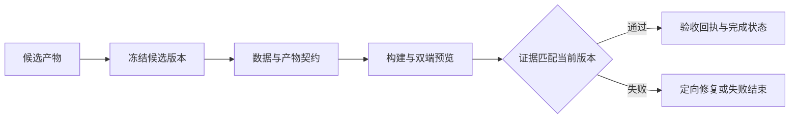

# 项目案例：沪深 300 趋势研究

[仓库首页](../README.md) · [架构设计](architecture.md) · [验证记录](validation-status.md)

用户提出“分析沪深 300 的近期趋势”，需要看到所用行情、指标口径和图表，也需要知道这次任务是否真正完成。SignalForge 把这些内容放在同一个研究工作空间中。

## 一个实际交付样本

2026-11-16 的 `index-technical-hs300` 任务使用 120 根日线，通过正式 `/act` 入口执行。PI Agent 运行 3 轮，生成 Next.js 看板；构建、数据契约、桌面及移动预览均通过，Mission 关联 accepted receipt 后完成。该次耗时 44.021 秒，无异常工具失败、无修复轮次。

图表节选见[仓库首页](../README.md)。这是一个实际模型生成样本，不是完整发布回归或成功率统计；原始报告哈希与构建身份见[脱敏验收摘要](evidence/20261116-basic-fullstack.json)。

| 阶段 | 系统职责 | 留下的记录 |
| --- | --- | --- |
| 解析与核对 | 模型提取研究意图，Resolver 独立确认指数身份 | 原始请求、改写结果、金融计划 |
| 数据准备 | FastAPI 提供行情和指标，优先复用本地覆盖 | 数据来源、质量说明、实际输入 |
| 生成 | PI Agent 使用受控工具与阶段 Skills 编写页面 | 看板源码、工具事件、运行用量 |
| 交付 | 提交候选版本，再检查数据、构建与预览 | 当前版本的验证报告与验收回执 |

## 为什么先固定研究计划

证券核对与初始计划在 Agent 工具循环前完成。模型负责语义提取；证券代码、资产类型、时间区间和参数由确定性规则检查。缺少信息时澄清，模型不可用时停止。

Skills 负责阶段规则、参考资料及完成条件，覆盖取数、回测、页面生成等能力。历史筛选、摘要与 Token 预算控制输入规模；连续无进展时停止工具循环，验证失败只修复明确失败项。标准任务也可走受控模板，评测会区分模板交付与真实模型生成。

实现：[研究计划](../src/lib/domains/finance/workspace.ts)、[查询改写](../src/lib/domains/finance/query-rewrite.ts)、[PI 执行](../src/lib/agent/pi/run-engine.ts)、[Skills](../.pi/skills.registry.json)。

## 为什么保留计算输入

行情、指标与回测在 Python/FastAPI 中计算。TimescaleDB 保存历史行情，Redis 缓存分时读取；PostgreSQL 保存任务状态、索引和摘要，大型数据及源码放在项目工作空间。

以 510300 的 20/60 日均线回测为例，请求先冻结窗口、评估日期、复权和费用配置。区间前数据仅用于预热，收盘产生信号，下一根开盘模拟成交，费用与固定滑点进入资金账本。实验保存实际行情、参数、引擎身份和哈希，支持离线复算及独立账本核对。

哈希用于检查内容变化；复算一致不证明策略有效，也不能保证历史时点一定能取得同一份数据。此回测示例与上面的指数技术分析样本分别验收，不能用技术图表替代回测证据。

实现与口径：[回测服务](../services/market-data/)、[研究正确性](research-correctness.md)、[离线复跑](strategy-platform-guide.md#保存回测并离线复跑)。

## 为什么不能在 Agent 回复后直接完成

`AgentRun` 记录一次物理执行，`Mission` 记录用户要求的交付。Agent 写完代码后，平台仍需确认页面能构建、数据与请求一致、预览可访问，且证据属于当前版本。

验收回执与 Mission 完成状态在数据库事务中关联，旧版本检查不能完成新版本交付。任务首次入队锁定项目行，Job 与 Outbox 同事务写入；Worker 用租约、心跳和 fencing 拒绝失联执行者的迟到写入，同项目保持单写。

真实 PostgreSQL 集成已覆盖并发首次入队、幂等冲突、失联接管及迟到结果。恢复需要重新规划，不承诺从任意工具调用断点继续。生成代码的构建与预览使用 Linux namespace 隔离。

实现：[任务队列](../src/lib/quant/generation-queue.ts)、[Mission store](../src/lib/services/pi-agent-mission-store.ts)、[证据核验](../src/lib/agent/mission/evidence-verifier.ts)。验证方法见[后端可靠性](backend-reliability.md)。
